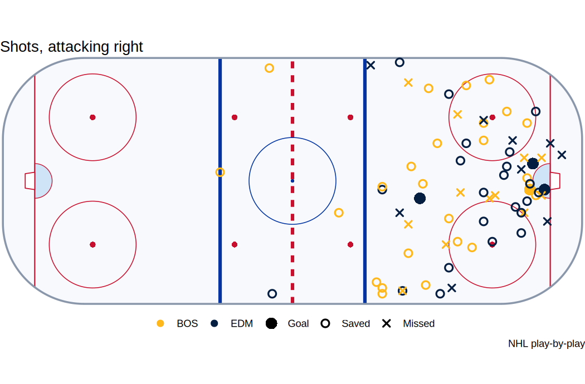
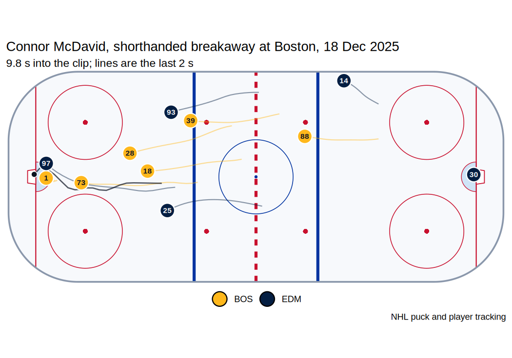
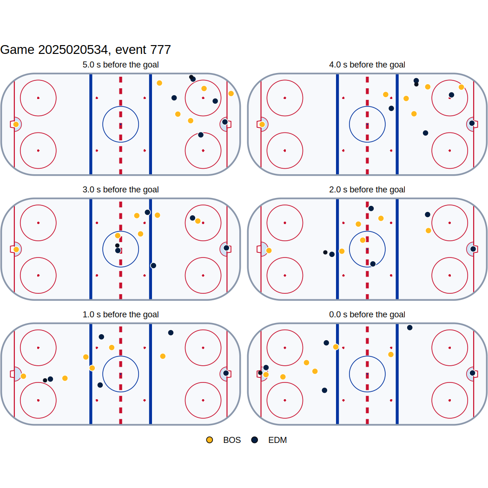
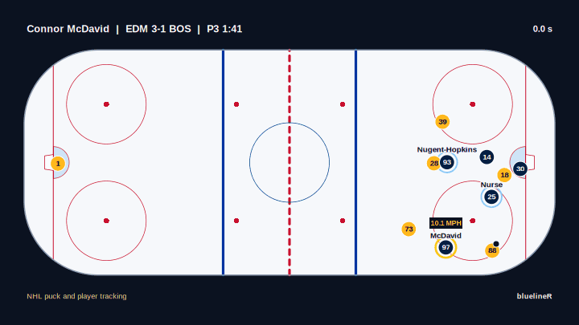
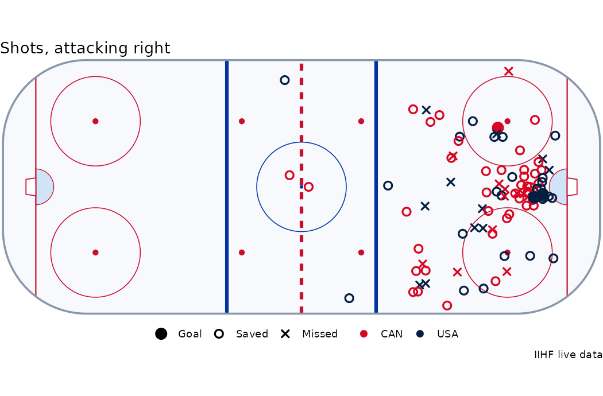

<picture>
  <source media="(prefers-color-scheme: dark)" srcset="man/figures/logo-dark.png">
  
</picture>

<!-- badges: start -->

[](https://github.com/ethanrawson/bluelineR/actions/workflows/R-CMD-check.yaml)
[](https://ethanrawson.github.io/bluelineR/)
[](https://lifecycle.r-lib.org/articles/stages.html#experimental)
[](LICENSE.md)
<!-- badges: end -->

bluelineR wraps the public APIs behind NHL.com and returns tidy tibbles:
scores, schedules, standings, play-by-play, box scores and shift charts;
players, rosters, stat leaders and the draft; the stats and records
APIs; **NHL EDGE** skating, shot and zone-time tracking; and the **puck
and player tracking frames behind every goal since 2023-24**, ten frames
a second, with tools that read how each goal was scored and draw it on a
rink.

It grew out of [BluelineMetrics](https://bluelinemetrics.com), where
these endpoints feed the live game tracker, the goal replays and the
player pages.

## Installation

``` r
# install.packages("pak")
pak::pak("ethanrawson/bluelineR")
```

## A game

``` r
library(bluelineR)

nhl_scores("2026-10-20")[, c("id", "away_team_abbrev", "away_team_score", "home_team_abbrev", "home_team_score")]
#> # A tibble: 11 × 5
#>           id away_team_abbrev away_team_score home_team_abbrev home_team_score
#>        <int> <chr>                      <int> <chr>                      <int>
#> 1 2026020141 SJS                            4 MTL                            3
#> 2 2026020142 COL                            3 NJD                            4
#> 3 2026020143 ANA                            2 NYI                            3
#> 4 2026020144 LAK                            5 WSH                            2
#> 5 2026020145 TOR                            6 CBJ                            2
#> # ℹ 6 more rows
```

Play-by-play comes back one row per event, with the clock in seconds,
the strength, the players by name, the running score, and the location
turned so the shooting team always attacks to the right:

``` r
pbp <- nhl_pbp(2025020534)
pbp[pbp$type == "goal", c("period", "time_in_period", "event_team", "strength_state", "player_1_name", "x_fixed", "y_fixed")]
#> # A tibble: 4 × 7
#>   period time_in_period event_team strength_state player_1_name       x_fixed y_fixed
#>    <int> <chr>          <chr>      <chr>          <chr>                 <dbl>   <dbl>
#> 1      1 13:38          EDM        5v4            Ryan Nugent-Hopkins      44      -6
#> 2      1 16:27          BOS        5v4            Pavel Zacha              82      -3
#> 3      2 14:38          EDM        5v5            Quinn Hutson             83       6
#> 4      3 01:41          EDM        4v5            Connor McDavid           87      -3
```

`plot_shots()` puts each club at its own end, the away club at the left net:

``` r
plot_shots(pbp)
```



## A goal, from the tracking

The NHL keeps about fourteen seconds of tracking behind every goal.
`nhl_goal_tracking()` fetches it (the files only answer requests that
come from nhl.com, so it says it does) as one row per skater, goalie and
puck per frame, in feet:

``` r
frames <- nhl_goal_tracking(2025020534, 777)
frames
#> # A tibble: 1,683 × 9
#>   frame  time entity_id is_puck player_id sweater_number team      x       y
#>   <int> <dbl>     <dbl> <lgl>       <dbl>          <dbl> <chr> <dbl>   <dbl>
#> 1     1     0         1 TRUE           NA             NA <NA>   77.9 -30.7  
#> 2     1     0      6001 FALSE     8480280              1 BOS   -87.3  -0.403
#> 3     1     0      6018 FALSE     8478401             18 BOS    81.0  -4.75 
#> 4     1     0      6028 FALSE     8477496             28 BOS    54.4  -0.288
#> 5     1     0      6039 FALSE     8479987             39 BOS    57.7  15.4  
#> # ℹ 1,678 more rows
```

`classify_goal()` reads how it was scored. The same rules build the goal
types on BluelineMetrics, and the R port matches them goal for goal:

``` r
goal <- classify_goal(frames, team = "EDM", shot_type = "backhand")
goal[, c("shooter", "distance", "shot_speed", "since_neutral", "kinds")]
#> # A tibble: 1 × 5
#>   shooter distance shot_speed since_neutral kinds          
#>     <dbl>    <dbl>      <dbl>         <dbl> <chr>          
#> 1 8478402      7.5       24.1           2.8 rush, breakaway
```

``` r
plot_goal(frames, title = "Connor McDavid, shorthanded breakaway at Boston, 18 Dec 2025")
```



``` r
plot_goal_sequence(frames, n = 6, seconds = 5)
```



`animate_goal()` plays it back as an MP4: every player and the puck, the scorer and his assists named,
his skating speed, and the last three seconds again at half speed (it needs the
[av](https://docs.ropensci.org/av/) package).

``` r
animate_goal(frames, "mcdavid.mp4", goal = nhl_goal_replay(2025020534, 777))
```



## Game tracking summaries

For 2021-22 to 2023-24 (and some of 2020-21 and 2024-25) the NHL’s
tracking vendor left a summary of every game: each player’s skating
speed, distance, zone time and zone starts, and **his puck possession
time**, in all, by zone and by strength, with each club’s possession
share. Individual possession is not in NHL EDGE.

``` r
tr <- nhl_tracking_summary(2023020500)
tr$teams[, c("team", "possession_pct", "possession_pct_o_zone", "possession_pct_d_zone")]
#> # A tibble: 2 × 4
#>   team  possession_pct possession_pct_o_zone possession_pct_d_zone
#>   <chr>          <dbl>                 <dbl>                 <dbl>
#> 1 FLA             51.5                  45.4                  34.4
#> 2 STL             48.5                  38.4                  42.0
top <- tr$players[order(-tr$players$possession_time), ]
top[, c("name", "team", "time_on_total", "possession_time", "possession_time_o_zone", "speed_max_mph", "distance_miles")]
#> # A tibble: 40 × 7
#>   name       team  time_on_total possession_time possession_time_o_zone speed_max_mph distance_miles
#>   <chr>      <chr>         <int>           <int>                  <int>         <dbl>          <dbl>
#> 1 Colton Pa… STL            1339              61                      5          20.7           3.28
#> 2 Brandon M… FLA            1704              57                     15          20.9           3.64
#> 3 Aaron Ekb… FLA             899              54                      8          20.2           3.27
#> 4 Jordan Ky… STL             960              48                     25          20.9           2.93
#> 5 Sam Reinh… FLA             759              45                     18          20.7           2.99
#> # ℹ 35 more rows
```

## NHL EDGE

``` r
nhl_edge_leaders("skater_speed", season = "2025-26")[, c("rank", "player_first_name", "player_last_name", "player_team_abbrev", "max_speed_imperial", "bursts_over22")]
#> # A tibble: 10 × 6
#>    rank player_first_name player_last_name player_team_abbrev max_speed_imperial bursts_over22
#>   <int> <chr>             <chr>            <chr>                           <dbl>         <int>
#> 1     1 Beck              Malenstyn        BUF                              24.9            14
#> 2     2 Nathan            MacKinnon        COL                              24.8            45
#> 3     3 Connor            McDavid          EDM                              24.6           151
#> 4     4 Logan             Cooley           UTA                              24.4            33
#> 5     5 Jake              Sanderson        OTT                              24.4            31
#> # ℹ 5 more rows

mcdavid <- nhl_edge_skater(8478402, "2025-26")
mcdavid$info[, c("skating_speed_speed_max_imperial", "skating_speed_speed_max_percentile", "top_shot_speed_imperial", "total_distance_skated_imperial")]
#> # A tibble: 1 × 4
#>   skating_speed_speed_max_imp…¹ skating_speed_speed_…² top_shot_speed_imper…³ total_distance_skate…⁴
#>                           <dbl>                  <dbl>                  <dbl>                  <dbl>
#> 1                          24.6                  0.997                   82.0                   330.
#> # ℹ abbreviated names: ¹​skating_speed_speed_max_imperial, ²​skating_speed_speed_max_percentile,
#> #   ³​top_shot_speed_imperial, ⁴​total_distance_skated_imperial
```

## Best-on-best tournaments

Every tournament NHL players have played in: the Canada Cup, the World Cup of Hockey, the Olympics and
the 4 Nations Face-Off, from 1976 to 2026. Each player's and club's numbers at each one, careers with
Olympic medals, every game and every final. The game ids open the NHL's play-by-play, in full for the 4
Nations and the 2016 World Cup and goals and penalties for the Olympics, and the 4 Nations goals have
player tracking: `animate_goal(nhl_goal_tracking(2024200007, 1443), goal = nhl_goal_replay(2024200007, 1443))`
is McDavid's overtime winner in the final.

``` r
oly <- nhl_international("skater", "olympics", 2026)
oly[, c("first_name", "last_name", "tri_code", "games_played", "goals", "assists", "points", "toi_seconds")]
#> # A tibble: 264 × 8
#>   first_name last_name  tri_code games_played goals assists points toi_seconds
#>   <chr>      <chr>      <chr>           <int> <int>   <int>  <int>       <int>
#> 1 Connor     McDavid    CAN                 6     2      11     13        7285
#> 2 Macklin    Celebrini  CAN                 6     5       5     10        7119
#> 3 Lucas      Raymond    SWE                 5     1       8      9        5560
#> 4 Joel       Armia      FIN                 6     3       5      8        4639
#> 5 Juraj      Slafkovský SVK                 6     4       4      8        7145
#> # ℹ 259 more rows

winners <- nhl_international_winners()
print(winners[, c("tournament", "year", "winning_tricode", "winning_score", "losing_tricode", "losing_score", "overtime")], n = 15)
#> # A tibble: 15 × 7
#>    tournament           year winning_tricode winning_score losing_tricode losing_score overtime
#>    <chr>               <dbl> <chr>                   <int> <chr>                 <int> <chr>   
#>  1 Canada Cup           1976 CAN                         5 TCH                       4 OT      
#>  2 Canada Cup           1981 URS                         8 CAN                       1 <NA>    
#>  3 Canada Cup           1984 CAN                         6 SWE                       5 <NA>    
#>  4 Canada Cup           1987 CAN                         6 URS                       5 <NA>    
#>  5 Canada Cup           1991 CAN                         4 USA                       2 <NA>    
#>  6 World Cup of Hockey  1996 USA                         5 CAN                       2 <NA>    
#>  7 Olympics             1998 CZE                         1 RUS                       0 <NA>    
#>  8 Olympics             2002 CAN                         5 USA                       2 <NA>    
#>  9 World Cup of Hockey  2004 CAN                         3 FIN                       2 <NA>    
#> 10 Olympics             2006 SWE                         3 FIN                       2 <NA>    
#> 11 Olympics             2010 CAN                         3 USA                       2 OT      
#> 12 Olympics             2014 CAN                         3 SWE                       0 <NA>    
#> 13 World Cup of Hockey  2016 CAN                         2 EUR                       1 <NA>    
#> 14 4 Nations Face-Off   2025 CAN                         3 USA                       2 OT      
#> 15 Olympics             2026 USA                         2 CAN                       1 OT

games <- nhl_international_games("4 nations")
final <- nhl_pbp(games$game_id[games$series_title == "Final"])
final[final$type == "goal", c("period", "time_in_period", "event_team", "player_1_name", "x_fixed", "y_fixed")]
#> # A tibble: 5 × 6
#>   period time_in_period event_team player_1_name    x_fixed y_fixed
#>    <int> <chr>          <chr>      <chr>              <dbl>   <dbl>
#> 1      1 04:48          CAN        Nathan MacKinnon      41       7
#> 2      1 16:52          USA        Brady Tkachuk         80      -1
#> 3      2 07:32          USA        Jake Sanderson        73       7
#> 4      2 14:00          CAN        Sam Bennett           81      10
#> 5      4 08:18          CAN        Connor McDavid        68       6
```

## IIHF tournaments: every shot, located

The IIHF's live-data feed has every game of its championships (the World Championship, the World
Juniors, the women's and under-18 Worlds and the divisions) and the 2026 Olympics, with every shot
placed on the ice from the 2019 tournaments on, goals and penalties, and each period's team stats. The
2026 Olympic final, Jack Hughes in overtime:

``` r
shots <- iihf_shots(1010000058)
shots[shots$result == "goal", c("period", "time", "team", "player_name", "x", "y", "distance")]
table(shots$team, shots$result)

wm <- iihf_schedule(2026, "wm")
wm[wm$phase %in% c("Semifinals", "BronzeMedalGame", "GoldMedalGame"), c("game_id", "date", "phase", "home_team", "away_team", "home_score", "away_score")]
#> # A tibble: 3 x 7
#>   period time  team  player_name     x     y distance
#>   <chr>  <chr> <chr> <chr>       <dbl> <dbl>    <dbl>
#> 1 1      06:00 USA   Matt Boldy   80.8 -2.38     8.54
#> 2 2      38:16 CAN   Cale Makar   65.8 19.8     30.5 
#> 3 OT     61:41 USA   Jack Hughes  78   -3.57    11.6 
#>      
#>       blocked goal missed saved
#>   CAN      24    1     12    41
#>   USA      17    2     12    26
#> # A tibble: 4 x 7
#>   game_id date       phase           home_team away_team home_score away_score
#>   <chr>   <date>     <chr>           <chr>     <chr>          <int>      <int>
#> 1 12917   2026-05-30 Semifinals      SUI       NOR                6          0
#> 2 12918   2026-05-30 Semifinals      CAN       FIN                2          4
#> 3 12919   2026-05-31 BronzeMedalGame CAN       NOR                2          3
#> 4 12920   2026-05-31 GoldMedalGame   SUI       FIN                0          1
```

``` r
plot_shots(shots)
```



## DraftKings odds and player props

ESPN's NHL odds come from DraftKings: every game's moneyline, puck line and total, opening and current,
and DraftKings' player props (shots, points, assists, saves, goalscorer, milestones, club totals), each
over/under as one row with the no-vig chance and the player's NHL id.

``` r
odds <- espn_odds()
odds[, c("home_team", "away_team", "home_ml", "away_ml", "home_win_prob", "total_line", "over_price", "under_price")]

props <- espn_props()
props[props$stat %in% "shots", c("team", "player_name", "player_id", "line", "over", "under", "over_prob")]
```

## How far back it goes

Every season since 1917-18 is in the NHL's data, but each kind of number starts in its own year, and a column
the league did not keep comes back missing (or zero) before then. `nhl_stat_eras()` has the eras and, with
`by = "stat"`, the first season of each stats column, measured against the live API; `nhl_stats()`,
`nhl_pbp()` and `nhl_shifts()` say so when you ask for something older than the data.

| From | What starts |
|---|---|
| 1917-18 | Goals, assists, points, penalty minutes; goalie wins, goals against and shutouts; every game's boxscore, player game logs, and play-by-play of goals and penalties |
| 1933-34 | Even-strength, power-play and short-handed goals and points |
| 1955-56 | Goalies' shots against, saves and save percentage |
| 1959-60 | Shots and plus/minus |
| 1977-78 | Team power-play and penalty-kill percentages |
| 1997-98 | Ice time, shifts and faceoffs; shots on goal in the play-by-play |
| 2005-06 | Hits, blocked shots, giveaways, takeaways and missed shots |
| 2009-10 | Every event in the play-by-play, with its location (shot maps) |
| 2010-11 | Shift charts |
| 2021-22 | NHL EDGE tracking |
| 2023-24 | Goal tracking |

Gretzky's 1981-82, from the league's numbers and his game log: 92 goals, and the fiftieth in his
thirty-ninth game.

``` r
nhl_stats("skater/summary", "1981-82", sort = "points", limit = 5)[, c("skater_full_name", "team_abbrevs", "goals", "assists", "points")]
#> # A tibble: 5 × 5
#>   skater_full_name team_abbrevs goals assists points
#>   <chr>            <chr>        <int>   <int>  <int>
#> 1 Wayne Gretzky    EDM             92     120    212
#> 2 Mike Bossy       NYI             64      83    147
#> 3 Peter Stastny    QUE             46      93    139
#> 4 Dennis Maruk     WSH             60      76    136
#> 5 Bryan Trottier   NYI             50      79    129
log <- nhl_player_game_log(8447400, "1981-82")
log <- log[order(log$game_date), ]
fifty <- which(cumsum(log$goals) >= 50)[1]
fifty
#> [1] 39
log[fifty, c("game_date", "opponent_abbrev", "goals", "assists")]
#> # A tibble: 1 × 4
#>   game_date  opponent_abbrev goals assists
#>   <date>     <chr>           <int>   <int>
#> 1 1981-12-30 PHI                 5       1
```

## The stats API

``` r
nhl_stats("skater/summary", "2025-26", sort = "points", limit = 5)[, c("skater_full_name", "team_abbrevs", "goals", "assists", "points")]
#> # A tibble: 5 × 5
#>   skater_full_name  team_abbrevs goals assists points
#>   <chr>             <chr>        <int>   <int>  <int>
#> 1 Connor McDavid    EDM             48      90    138
#> 2 Nikita Kucherov   TBL             44      86    130
#> 3 Nathan MacKinnon  COL             53      74    127
#> 4 Macklin Celebrini SJS             45      70    115
#> 5 Mark Scheifele    WPG             36      67    103
```

## The records site

records.nhl.com keeps a century of tables. `nhl_records_catalog()` lists the 78 that answer, each with a line on
what it holds, and helpers cover the ones people ask for: Game 7, overtime, season-opener, outdoor and overseas
records, the draft lottery and its odds, and the milestones in sight.

``` r
nhl_franchise_records("game7")[1:5, c("franchise_name", "games_played", "wins", "losses")]
#> # A tibble: 5 × 4
#>   franchise_name      games_played  wins losses
#>   <chr>                      <int> <int>  <int>
#> 1 Boston Bruins                 31    16     15
#> 2 Toronto Maple Leafs           28    12     16
#> 3 Montréal Canadiens            26    17      9
#> 4 Detroit Red Wings             25    14     11
#> 5 St. Louis Blues               19    10      9
nhl_draft_lottery(2026)[, c("draft_year", "pick", "lottery_team", "player_name", "effect")]
#> # A tibble: 2 × 5
#>   draft_year  pick lottery_team player_name   effect               
#>        <int> <int> <chr>        <chr>         <chr>                
#> 1       2026     1 TOR          Gavin McKenna Moved from 5th to 1st
#> 2       2026     2 SJS          Ivar Stenberg Moved from 9th to 2nd
```

## What it covers

| Area                        | Functions                                                                                                                                   | Endpoint                                                                                           |
|-----------------------------|---------------------------------------------------------------------------------------------------------------------------------------------|----------------------------------------------------------------------------------------------------|
| Scores, schedule, standings | `nhl_scores()`, `nhl_schedule()`, `nhl_team_schedule()`, `nhl_standings()`                                                                  | `api-web.nhle.com/v1/score`, `/schedule`, `/club-schedule-season`, `/standings`                    |
| Games                       | `nhl_pbp()`, `nhl_boxscore()`, `nhl_game()`, `nhl_shifts()`                                                                                 | `/gamecenter/{id}/play-by-play`, `/boxscore`, `/landing`; `api.nhle.com/stats/rest/en/shiftcharts` |
| Goal tracking               | `nhl_goal_tracking()`, `nhl_goal_replay()`, `goal_frame()`, `classify_goal()`, `goal_context()`, `skater_speed()`, `plot_goal()`, `animate_goal()`            | `wsr.nhle.com/sprites/{season}/{game}/ev{event}.json`, `/ppt-replay/goal`                          |
| Game tracking summaries     | `nhl_tracking_summary()`, `nhl_tracking_player_stats()`, `nhl_tracking_entities()`                                                          | `live.nhle.com/ppt/{season}/{game}/` (2021-22 to 2023-24, some of 2020-21 and 2024-25)             |
| NHL EDGE                    | `nhl_edge_skater()`, `nhl_edge_goalie()`, `nhl_edge_team()`, `nhl_edge_leaders()`, `nhl_edge_landing()`, `nhl_edge_by_the_numbers()`        | `/edge/...` (20 reports)                                                                           |
| Players and clubs           | `nhl_player()`, `nhl_player_game_log()`, `nhl_player_search()`, `nhl_roster()`, `nhl_prospects()`, `nhl_team_stats()`, `nhl_stat_leaders()` | `/player`, `/roster`, `/prospects`, `/club-stats`, `/skater-stats-leaders`; `search.d3.nhle.com`   |
| Draft                       | `nhl_draft_rankings()`, `nhl_draft_picks()`                                                                                                 | `/draft/rankings`, `/draft/picks`                                                                  |
| International | `nhl_international()`, `nhl_international_careers()`, `nhl_international_games()`, `nhl_international_winners()`, `nhl_olympic_podiums()` | `records.nhl.com/site/api/international-*`, `/olympic-*` |
| Stats and records APIs      | `nhl_stats()`, `nhl_stats_reports()`, `nhl_teams()`, `nhl_seasons()`, `nhl_franchises()`, `nhl_records()`                                   | `api.nhle.com/stats/rest/en`, `records.nhl.com/site/api`                                           |
| IIHF tournaments | `iihf_schedule()`, `iihf_olympic_games()`, `iihf_game()`, `iihf_shots()`, `iihf_events()`, `iihf_period_stats()` | `realtime.iihf.com/gamestate/GetLatestState/{game}`; schedules from `canada-central.iihf.com` |
| DraftKings odds and props | `espn_odds()`, `espn_props()`, `devig()` | `site.api.espn.com/.../scoreboard`; `sports.core.api.espn.com/.../odds/100/propBets` |
| Players, clubs and games, more | `nhl_player_bio()`, `nhl_team_comparison()`, `nhl_broadcasts()`, `nhl_quick_stats()`, `nhl_news()`, `nhl_videos()`, `espn_player_splits()` | `api-web.nhle.com/v2/player/{id}/bio`, `/v1/team-stats-comparison`, `/v1/how-to-watch`; `live.nhle.com/psr`; `forge-dapi.d3.nhle.com/v2/content`; ESPN athlete splits |
| Playoff history | `nhl_playoff_series()`, `nhl_playoff_games()` | `records.nhl.com/site/api/playoff-franchise-vs-team`, `/yearly-playoff-series-details` |
| Records | `nhl_franchise_records()`, `nhl_draft_lottery()`, `nhl_draft_lottery_odds()`, `nhl_milestones()`, `nhl_records_catalog()` | `records.nhl.com/site/api/franchise-all-time-*`, `/neutral-site-standings`, `/draft-lottery-*`; `api.nhle.com/stats/rest/en/milestones` |
| Images | `nhl_headshot_url()`, `nhl_logo_url()`, `nhl_jersey_url()`; broadcaster logos in `nhl_broadcasts()` | `assets.nhle.com/mugs`, `/logos/nhl`, `/textures/nhl/jersey`, `/logos/broadcast` |
| Anything else               | `nhl_api()`, `tidy_json()`                                                                                                                  | any of the above                                                                                   |

## Being a good guest

These are the NHL’s own, undocumented APIs; bluelineR is not affiliated
with the NHL, and endpoints can change without notice. Requests are
throttled (five a second by default) and retried with backoff on rate
limits; turn on `options(bluelineR.cache = TRUE)` to keep responses for
the session.

bluelineR stands on the work of other R hockey packages, notably
[nhlscraper](https://rentosaijo.github.io/nhlscraper/),
[hockeyR](https://cran.r-project.org/package=hockeyR) and
[fastRhockey](https://cran.r-project.org/package=fastRhockey). nhlscraper was first to the goal tracking
frames: its `replay()` has read them from `wsr.nhle.com` since November 2025, and `replays()` serves a
season of them at once. What bluelineR adds:

* **Game tracking summaries** (`nhl_tracking_summary()`): each player's puck possession time, by zone
  and strength, with speed, distance, zone time and zone starts, and each club's possession share, from
  the per-game files at `live.nhle.com/ppt`.
* **Reading a goal from its tracking** (`classify_goal()`): rush, breakaway, odd-man rush, one-timer,
  cross-slot pass, traffic, behind the net and the forecheck, with who carried it in and who made the
  pass, and the frame the puck went in (`goal_frame()`).
* **Goal replays as video** (`animate_goal()`): the tracking played back on a rink as an MP4, with
  the scorer and his assists named, his skating speed and the finish again in slow motion.
* **Best-on-best tournaments** (`nhl_international()` and the rest): every Canada Cup, World Cup,
  Olympics and 4 Nations from records.nhl.com, with careers, Olympic medals, every game and every final.
* **IIHF tournaments with every shot located** (`iihf_shots()` and the rest): the World Championship,
  World Juniors, women's and under-18 Worlds, the divisions and the 2026 Olympics, from the IIHF's
  live-data feed, which no other package reads.
* **DraftKings player props** (`espn_props()`): ESPN's prop list for every game, over and under paired
  and each player matched to his NHL id, with game lines (`espn_odds()`) and `devig()`.
* **The newer NHL endpoints**: the v2 player bio with every award and its season (`nhl_player_bio()`),
  the team comparison, the viewing guide, the quick standings and leader files, NHL.com news and
  videos, playoff series records and every playoff game, and all thirteen EDGE top-10 boards.
* **NHL EDGE** leaderboards, comparison reports and last night's standouts, the goal replay summary
  (`nhl_goal_replay()`) and player search.
